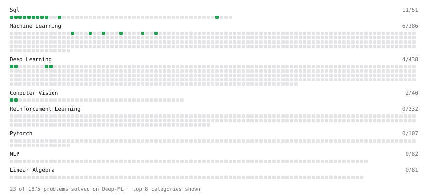

# Deep-ML

My machine learning practice from [Deep-ML](https://www.deep-ml.com). Every solution here was written by hand.

**20** solved · 20 problems · 0 labs · 0 math

[**Browse the interactive portfolio**](https://anhour-xyz.github.io/deep-ml/) to replay this filling in over time.

## Problems

| | Difficulty | Solved | |
| --- | --- | --- | --- |
| [Calculate Accuracy Score](https://www.deep-ml.com/problems/36) | easy | 2026-09-17 | [solution](problems/0036-calculate-accuracy-score) |
| [Calculate Image Brightness](https://www.deep-ml.com/problems/70) | easy | 2026-09-18 | [solution](problems/0070-calculate-image-brightness) |
| [Calculate Mean Absolute Error (MAE)](https://www.deep-ml.com/problems/93) | easy | 2026-09-19 | [solution](problems/0093-calculate-mean-absolute-error-mae) |
| [Calculate Root Mean Square Error (RMSE)](https://www.deep-ml.com/problems/71) | easy | 2026-09-17 | [solution](problems/0071-calculate-root-mean-square-error-rmse) |
| [Count rows per group](https://www.deep-ml.com/problems/1107) | easy | 2026-11-01 | [solution](problems/1107-count-rows-per-group) |
| [Detect Overfitting or Underfitting](https://www.deep-ml.com/problems/86) | easy | 2026-09-17 | [solution](problems/0086-detect-overfitting-or-underfitting) |
| [Filter rows with WHERE](https://www.deep-ml.com/problems/1103) | easy | 2026-09-18 | [solution](problems/1103-filter-rows-with-where) |
| [Grayscale Image Contrast Calculator](https://www.deep-ml.com/problems/82) | easy | 2026-09-18 | [solution](problems/0082-grayscale-image-contrast-calculator) |
| [Implement Precision Metric](https://www.deep-ml.com/problems/46) | easy | 2026-09-19 | [solution](problems/0046-implement-precision-metric) |
| [Implement Recall Metric in Binary Classification](https://www.deep-ml.com/problems/52) | easy | 2026-09-21 | [solution](problems/0052-implement-recall-metric-in-binary-classification) |
| [Implement ReLU Activation Function](https://www.deep-ml.com/problems/42) | easy | 2026-09-18 | [solution](problems/0042-implement-relu-activation-function) |
| [Leaky ReLU Activation Function](https://www.deep-ml.com/problems/44) | easy | 2026-09-18 | [solution](problems/0044-leaky-relu-activation-function) |
| [Remove duplicates with DISTINCT](https://www.deep-ml.com/problems/1105) | easy | 2026-11-01 | [solution](problems/1105-remove-duplicates-with-distinct) |
| [SELECT all rows](https://www.deep-ml.com/problems/1101) | easy | 2026-09-18 | [solution](problems/1101-select-all-rows) |
| [Select specific columns](https://www.deep-ml.com/problems/1102) | easy | 2026-09-18 | [solution](problems/1102-select-specific-columns) |
| [Sigmoid Activation Function Understanding](https://www.deep-ml.com/problems/22) | easy | 2026-09-17 | [solution](problems/0022-sigmoid-activation-function-understanding) |
| [Softmax Activation Function Implementation ](https://www.deep-ml.com/problems/23) | easy | 2026-09-21 | [solution](problems/0023-softmax-activation-function-implementation) |
| [Sort results with ORDER BY](https://www.deep-ml.com/problems/1104) | easy | 2026-11-01 | [solution](problems/1104-sort-results-with-order-by) |
| [Top N with LIMIT](https://www.deep-ml.com/problems/1106) | easy | 2026-11-01 | [solution](problems/1106-top-n-with-limit) |
| [Your first JOIN](https://www.deep-ml.com/problems/1109) | easy | 2026-09-18 | [solution](problems/1109-your-first-join) |

---

_This file is regenerated by Deep-ML on every push._
